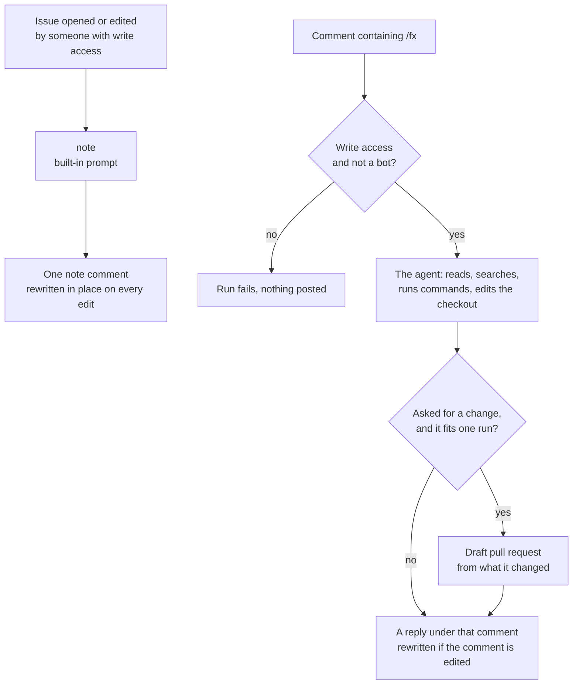

# fx agent action

[](https://github.com/khalido/fx-agent-action/actions/workflows/check.yml)

An agent on your issues. Open one and [fx](https://fx.sh), Vercel Labs'
coding agent, reads the code and leaves a note: where the issue lives, what
already exists, and the answer when the issue is a question.

Comment `/fx` with a question and it answers. Say "fix this" and it makes the
change, runs your checks and opens a draft pull request. If the change is too
big for one run, it says what it would change instead. It runs on your own
runner, with no app to install and no service in the middle.

```yaml
# .github/workflows/fx.yml
name: fx
on:
  issues:
    types: [opened, edited]
  issue_comment:
    types: [created, edited]
jobs:
  fx:
    if: >-
      (github.event_name == 'issues' && github.event.issue.user.type != 'Bot' &&
       (github.event.repository.private ||
        contains(fromJSON('["OWNER","MEMBER","COLLABORATOR"]'), github.event.issue.author_association)))
      || (github.event_name == 'issue_comment' && contains(github.event.comment.body, '/fx') &&
          github.event.comment.user.type != 'Bot' &&
          (github.event.repository.private ||
           contains(fromJSON('["OWNER","MEMBER","COLLABORATOR"]'), github.event.comment.author_association)))
    runs-on: ubuntu-latest
    timeout-minutes: 20
    concurrency:
      group: fx-${{ github.event_name }}-${{ github.event.issue.number }}
      cancel-in-progress: ${{ github.event_name == 'issues' }}
    permissions:
      contents: write
      pull-requests: write
      issues: write
    steps:
      - uses: actions/checkout@v7
        with:
          persist-credentials: false
          fetch-depth: 0
      - uses: khalido/fx-agent-action@main
        env:
          AI_GATEWAY_API_KEY: ${{ secrets.AI_GATEWAY_API_KEY }}
        with:
          max_steps: '60'
```

```bash
vercel ai-gateway api-keys create --name fx-REPO --limit 3 --refresh-period weekly --include-byok
gh secret set AI_GATEWAY_API_KEY
gh api -X PUT repos/OWNER/REPO/actions/permissions/workflow \
  -f default_workflow_permissions=read -F can_approve_pull_request_reviews=true
```

That is the setup. The [Vercel CLI](https://vercel.com/docs/cli) makes an
[AI Gateway](https://vercel.com/ai-gateway) key for this repo alone, with a
$3 budget that resets every week. `gh secret set` prompts for the key, which
keeps it out of your shell history; an unattended script passes `--body`. The
last command turns on the setting that lets a workflow open a pull request.

[`examples/fx.yml`](examples/fx.yml) is the same file with comments, and this
repo runs it on itself.

## What happens



Edit the issue and the note refreshes. Edit your comment and its reply
refreshes. Nothing merges without a person.

## Talking to it

**`/fx why is the sync running twice?`** reads the repo, the thread and the
git history, tries things in the checkout and runs the tests, then answers.
The checkout is thrown away.

**`/fx add a retry to the API client`** makes the change, runs your checks,
and what changed becomes a branch and a draft PR linked from the comment. The
agent decides that: when the change is bigger than one run or needs a call
that is not its to make, it says what it would change and where, and what a
stronger agent or a person should pick up. There is no magic word; the
workflow's `permissions:` block is what decides whether it can push at all.

**Never want a pull request?** Set `mode: answer`. The agent keeps its
shell, so it still runs your tests and tries the fix, but nothing is pushed.
To make a push impossible, not merely unasked for, also set
`contents: read`. Use both on a repo where `main` deploys on push. `mode: read`
also takes the shell away, so the agent can only read.

`/fx` can go anywhere in the comment, in any case, but not in a quoted
line. `trigger: '/fx, /agent'` accepts several phrases; widen the job's `if:`
to match. It is a slash and not a mention because `@fx` is a real person on
GitHub.

## Changing what it says

The built-in note is [`prompts/issue.md`](prompts/issue.md). When it gets
better here, it gets better in every repo on the next run. Your repo adds to
it in four ways.

**What your repo wants goes in [`AGENTS.md`](https://agents.md).** fx reads
it on every run, the same file your other agents read, and it may add to or
adjust the task. To add to the note, write two lines there: "when you leave a
note on an issue, name the design doc that covers it; anything that needs
taste is the maintainer's call". Put them under `## In CI` to keep them apart
from laptop instructions like "run the app and click".

**Skills.** The action ships two under [`skills/`](skills/): `open-pr`, how
a change ships, and `compare-models`, how to judge a gateway model. They are
copied into fx's skill folder on the runner for that run. fx also finds the
skill folders already in your repo. For skills only this agent should have,
use `.github/fx/skills/`. `skills: false` turns the copy off.
[`docs/skills.md`](docs/skills.md) lists the candidates for more.

**Memory.** The agent keeps one `MEMORY.md` on an `agent-memory` branch:
what earlier runs learned about this repo. Each run reads it first and may
edit it with its ordinary tools. The action pushes it back only from runs by
people with write access. When it grows past `memory_lines`, one cheap call
compacts it. Read it or edit it on the branch, or delete the branch to
forget. The push needs `contents: write`; fx never holds that token.

**A different note goes in `.github/fx/issue.md`.** When that file exists
the action uses it on issue events instead of the built-in note. Start from
the built-in text. `prompt` or `prompt_file` replaces the instruction for
every event the job handles, which suits a job that is not the note. On a
`/fx` comment, the comment is the prompt.

## Who can trigger a run, and what it can do

The action runs two checks first, the same two
[claude-code-action](https://github.com/anthropics/claude-code-action) runs:
write access to the repo on issue and PR events, and a human actor on every
event. If either says no, the run fails. `allowed_non_write_users` and
`allowed_bots` are the exceptions, and they only work with `mode: read`,
which has no shell and opens nothing. Keep the `if:` on the job too: it stops
a stranger's `/fx` from starting a runner at all.

Everyone with write access can get a change shipped, because the agent
decides when a request is worth a pull request. The workflow's
`permissions:` block decides what the agent can do, and branch protection is
what makes "at most a draft PR" true. The thread goes to the model as
evidence, with hidden markup stripped. The agent reads your repo's
`AGENTS.md` and skill folders, the same ones your laptop agent uses. Anyone
who can trigger a run can spend the key, so give the key its own budget. The
[guide](docs/guide.md#before-you-turn-it-on) has the full list, including
what a private repo on the free plan, which cannot have
[branch protection](https://docs.github.com/en/repositories/configuring-branches-and-merges-in-your-repository/managing-protected-branches/about-protected-branches),
is trusting.

## Inputs

All optional.

| Input | Default | |
|---|---|---|
| `prompt` | the comment, or the built-in note on an issue event | What to ask. The thread is appended below it. |
| `prompt_file` | | Instructions in a file in your repo. Wins over `prompt` and the built-in note when it exists. |
| `model` | `deepseek/deepseek-v4.1-flash-1017` | Any [AI Gateway model id](https://vercel.com/ai-gateway/models). |
| `mode` | `agent` | What a run may do. `agent` ships: shell, edits, and a draft PR when it decides to. `answer` verifies: the same shell, nothing ever committed or opened. `read` only reads: no shell, no PR. |
| `memory` | `true` | One `MEMORY.md` on an orphan branch, read before and pushed after each run. Your default branch is never touched. |
| `memory_branch`, `memory_repo`, `memory_lines` | `agent-memory`, this repo, `80` | Where the memory lives and how long it may get. |
| `skills` | `true` | Copy the action's skills and the repo's `.github/fx/skills/` to fx on the runner. |
| `trigger` | `/fx` | Whole word, anywhere in the comment. Comma-separate several. |
| `allowed_non_write_users` | | Logins exempt from the write check, or `*`. |
| `allowed_bots` | | Bots allowed to trigger, with or without `[bot]`, or `*`. |
| `max_steps` | `30` | Cap on the tool loop. Set here, so a repo's `.fx.json` cannot raise it. |
| `effort` | fx's `auto` | Reasoning effort, `low` to `max`, on models that have it. |
| `provider_order` | `wafer, baseten` | Up to 8 gateway providers to try first, then the gateway's own choice. Empty leaves it all to the gateway. |
| `timeout_minutes` | `10` | Stop fx after this long, so an unreachable model still ends in a comment. Keep it under the job's `timeout-minutes`. |
| `max_cost` | `2` | Fail when the footer's `~` cost estimate is over this many dollars, after the fact. A PR the agent asked for still opens. |
| `post` | `comment` | `none` leaves the answer on the `response` output. |
| `comment_key` | | Keeps this job's comment apart from another fx job's. |
| `session_artifact` | `true` | The run as one HTML file on the run page. |
| `github_token` | the workflow's | An App token for a named bot and CI on its PRs; [guide](docs/guide.md#a-bot-with-its-own-name). |
| `include_thread`, `include_diff` | `true` | What the agent sees besides title and body. |
| ~~`shell`~~, ~~`pr_model`~~ | | Removed in 1.1.0. Passing either fails the run and names the replacement; `shell: true` + `mode: read` is now `mode: answer`. |
| `issue_number`, `branch_prefix`, `working_directory` | | See [`action.yml`](action.yml). |

Outputs: `response`, `cost`, `steps`, `session_id`, `comment_url`, `pr_url`.

## Examples

- **[fx](examples/fx.yml)**: the one above, with comments.
- **[pr-review](examples/pr-review.yml)**: a review on open and on push, under 200 words, no praise.
- **[triage](examples/triage.yml)**: labels from the ones the repo has. The agent picks, the workflow applies.
- **[build-it](examples/build-it.yml)**: comments only, on a stronger model.
- **[weekly-deps](examples/weekly-deps.yml)**: bump, run your checks, one PR a week with a note.
- **[minimal-no-action](examples/minimal-no-action.yml)**: fx in two `run:` lines, no action at all.

## When it goes wrong

Every run uploads the session as one HTML file, kept a week: every tool
call with its arguments and result, web searches included. Read it before
guessing. The comment footer names the model and the provider that served it,
the tokens, the estimated cost and a link to the run.

## Why fx

I tried the bigger agents in this seat first. claude-code-action and
opencode's action are good, and heavy: slow to start, an app or a service in
the middle, more than an issue note needs. shaftoe's pi action was closer,
and this one took its comment marker and its 👀, but pi wants extensions for
the basics, and every extension I picked up did a billion things when I
wanted one. I started building my own. Then fx: skills, MCP, web search and
fetch, sessions you can read afterwards, one binary, none of it in the way.
This action is the GitHub plumbing around it and nothing else.

## The rest

[docs/guide.md](docs/guide.md) is everything else in one file: the three
modes, the prompt layer by layer, the actor checks in detail, pull requests
and App tokens, cost, and what fails on the first day. For an agent, the raw copy is
`https://raw.githubusercontent.com/khalido/fx-agent-action/main/docs/guide.md`.
[docs/prior-art.md](docs/prior-art.md) is what the other coding-agent actions
do and where this one differs. Working on the action itself?
[`AGENTS.md`](AGENTS.md), and fx's docs at
[fx.sh/llms.txt](https://fx.sh/llms.txt) first.

Apache-2.0, the same license as fx.
